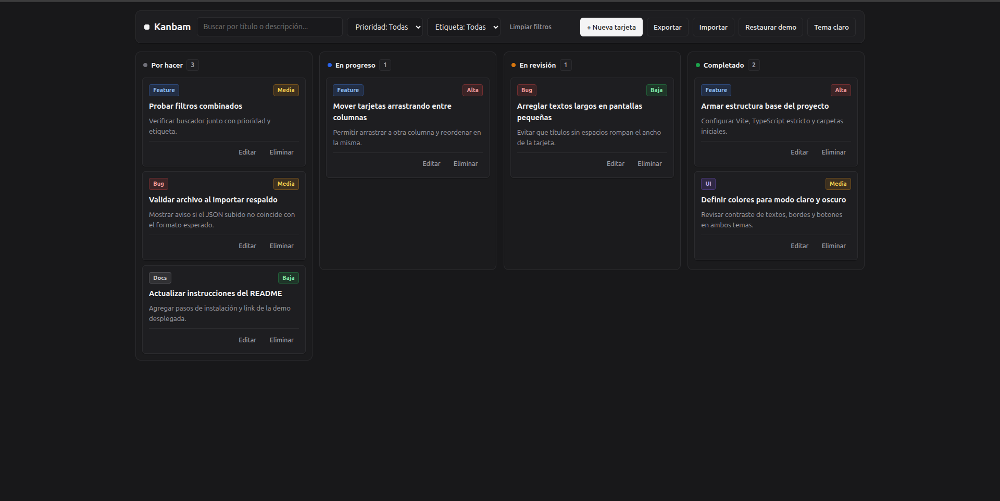

# Kanbam

Tablero Kanban interactivo construido con **Vanilla TypeScript**, **Vite** y **CSS moderno**, sin frameworks ni backend.

[](https://github.com/Salvador798/kanbam/actions/workflows/ci.yml)

**Demo en vivo:** [https://kanbam-xi.vercel.app/](https://kanbam-xi.vercel.app/)



## Motivación del proyecto

La mayoría de aplicaciones frontend hoy se construyen directamente sobre React, Vue o Angular, lo que muchas veces oculta cómo funcionan por debajo el DOM, la reactividad, el manejo de eventos y la seguridad en el navegador.

El objetivo de **Kanbam** fue construir una aplicación completa y lista para usar desde cero con **TypeScript estricto** y APIs nativas del navegador, demostrando dominio de los fundamentos del frontend: arquitectura modular, flujo de datos predecible, validación de datos externos, accesibilidad y diseño adaptable a cualquier pantalla.

## Funcionalidades

- **4 columnas fijas** (*Por hacer*, *En progreso*, *En revisión*, *Completado*) con contador, límites WIP informativos y tarjetas demo precargadas.
- **CRUD completo:** crear, editar (título, descripción, prioridad, etiquetas, fecha límite, subtareas) y eliminar con confirmación y opción de deshacer.
- **Mover tarjetas de tres formas:** arrastrar y soltar nativo (entre columnas y reordenando), teclado (`Alt` + flechas) y botones «Mover» en cada tarjeta para táctil.
- **Deshacer / rehacer** con historial para tareas, subtareas, movimientos y reordenamientos.
- **Búsqueda y filtros combinados:** texto, prioridad, etiqueta y fecha límite.
- **Respaldo y personalización:** exportar/importar `.json`, restaurar demo y tema claro/oscuro.

## Arquitectura

```text
domain  <──  application  <──  ui  ──>  interaction
   ▲              ▲                         
   └──────── infrastructure (adaptadores) ──┘ solo se conectan en main.ts
```

| Capa | Responsabilidad |
| --- | --- |
| `domain` | Núcleo puro: tipos, validación, fechas, operaciones inmutables que devuelven `Result`. Sin imports de otras capas ni del navegador. |
| `application` | Casos de uso: store inmutable con Pub/Sub, filtros, historial undo/redo y puertos (`BoardPersistence`, `ThemePersistence`, `BoardSerializer`). Solo importa `domain`. |
| `infrastructure` | Adaptadores: repositorio `localStorage`, esquema versionado, migraciones, migración del formato legado, guards de runtime, import/export JSON, seed. |
| `ui` | Componentes DOM (`Toolbar`, `Board`, `Column`, `TaskCard`, `TaskModal`, `Toast`), view-model y estilos. Importa `application` y tipos de `domain`. |
| `ui/interaction` | Lógica de interacción: funciones puras y testeadas (posición de drop, movimiento por teclado, atajos, anuncios) y controladores DOM delegados (drag & drop, controles de movimiento). |

**Regla de dependencias:** `domain` no importa nada; `application` solo importa `domain` y recibe la persistencia por puertos inyectados; `ui` importa `application` y tipos de `domain`; únicamente `main.ts` (composition root) conoce las implementaciones concretas de `infrastructure`. `domain` y `application` no usan `document`, `window` ni `localStorage`.

## Decisiones técnicas (sin framework)

- **Store inmutable + Pub/Sub:** cada cambio produce un estado nuevo, persiste y notifica a los suscriptores. Solo `Board` se re-renderiza; `Toolbar` y los modales se montan una vez y se actualizan con `sync()`, así el input de búsqueda no pierde el foco. Tras cada render se restaura el foco (`rememberFocus`).
- **`Result` en lugar de excepciones:** las operaciones de dominio y del store devuelven `{ ok, ... }`; la UI muestra los errores en un toast.
- **Esquema versionado + migraciones + migración del formato legado:** los datos guardados llevan versión y pasan por migraciones encadenadas; los datos del MVP antiguo se convierten al primer arranque.
- **Guards de runtime:** `localStorage` e importaciones JSON entran como `unknown` y se validan campo a campo (`isBoardState`, etc.). Si algo está corrupto, la app no se rompe y avisa.
- **DOM seguro:** el texto del usuario se inserta con `createElement` / `textContent`; `innerHTML` solo se usa con plantillas estáticas.
- **`<dialog>` nativo:** modales con foco y `Escape` gestionados por el navegador (no se intercepta `Escape`).
- **Posición de drop precisa:** `computeDropIndex` + `resolveStoreIndex` calculan el índice final aunque haya filtros activos que oculten tarjetas.
- **Listeners delegados:** drag & drop, movimiento por teclado y botones se registran una sola vez sobre el contenedor del tablero y sobreviven a los re-renders.

## Atajos de teclado

| Atajo | Acción |
| --- | --- |
| `N` | Nueva tarjeta |
| `/` | Enfocar la búsqueda |
| `Ctrl` + `Z` | Deshacer |
| `Ctrl` + `Y` / `Ctrl` + `Shift` + `Z` | Rehacer |
| `Alt` + `←` / `→` | Mover la tarjeta enfocada a la columna anterior / siguiente |
| `Alt` + `↑` / `↓` | Subir / bajar la tarjeta enfocada dentro de su columna |
| `Esc` | Cerrar diálogos |

Los atajos se ignoran al escribir en un campo y mientras hay un diálogo abierto. También están listados en el pie de la aplicación («Atajos de teclado»).

## Accesibilidad

- Tarjetas enfocables (`tabindex="0"`) con nombre accesible y descripción (`aria-describedby`) de cómo moverlas con `Alt` + flechas.
- Cada movimiento se anuncia en una región `aria-live="polite"` («“Título” movida a En progreso, posición 2 de 3») y el foco se conserva en la tarjeta movida.
- Botones «Mover» (← ↑ ↓ →) con `aria-label`, deshabilitados en los bordes del tablero: alternativa para táctil y para quien no puede arrastrar.
- `:focus-visible`, toasts con `role="status"`, `prefers-reduced-motion` y diseño responsive desde `320px`.

## Stack

- **TypeScript** estricto (`noUnusedLocals`, `noUnusedParameters`, `verbatimModuleSyntax`), cero dependencias en runtime.
- **Vite** + **pnpm**, **Vitest** para pruebas.
- **CSS moderno** (variables, Grid/Flexbox, CSS Nesting nativo).
- **APIs nativas:** HTML5 Drag & Drop, `localStorage`, `crypto.randomUUID()`, `<dialog>`, `<template>`, `Blob` / `File.text()`.

## Instalación y scripts

Requiere Node.js y `pnpm`.

```bash
pnpm install
pnpm dev          # servidor de desarrollo
pnpm build        # tsc + build de producción
pnpm preview      # vista previa del build
pnpm typecheck    # verificación de tipos
pnpm test         # pruebas (una ejecución)
pnpm test:watch   # pruebas en modo watch
```

## Integración continua

El workflow [`.github/workflows/ci.yml`](.github/workflows/ci.yml) se ejecuta en cada push a `main` y en cada pull request: instala dependencias con `pnpm`, y verifica tipos, pruebas y build. Repositorio: [Salvador798/kanbam](https://github.com/Salvador798/kanbam).

## Estructura del proyecto

```text
src/
├── domain/              # tipos, validación, fechas, operaciones puras con Result
├── application/         # store (Pub/Sub), filtros, historial, puertos
├── infrastructure/      # localStorage, esquema, migraciones, legado, guards, import/export, seed
├── ui/
│   ├── components/      # Toolbar, Board, Column, TaskCard, TaskModal, Toast
│   ├── interaction/     # drop-position, keyboard-move, shortcuts, announcer, touch-drag (puras)
│   │                    # dnd-controller, move-controls, move-runner (DOM delegado)
│   ├── styles/          # tokens, base, layout y estilos por componente
│   ├── utils/           # dom, focus, tags
│   ├── view-model.ts    # derivación de textos/estados para la vista
│   └── App.ts           # raíz de la UI: store, atajos, anunciador
└── main.ts              # composition root
tests/
├── unit/                # application, infrastructure, ui, ui-view
└── e2e/                 # flujos completos sobre dominio + store
```
